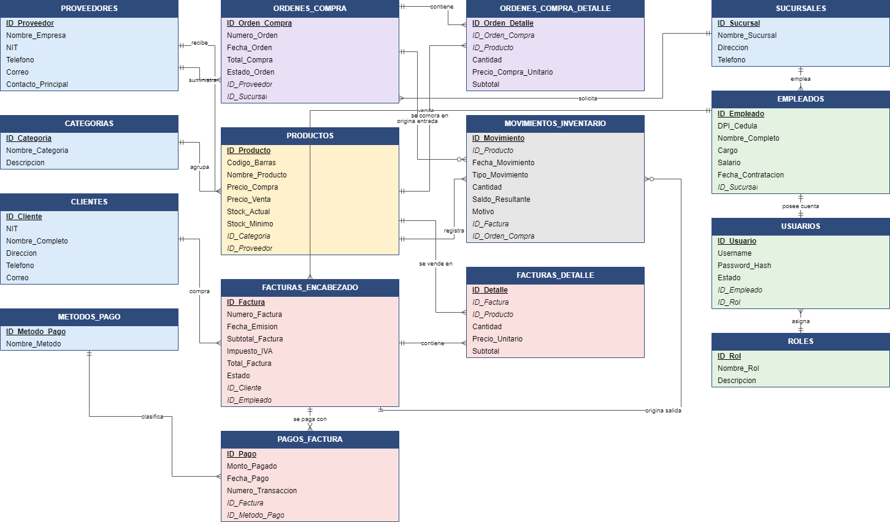

# Sistema de Inventario y Facturación (Ferretería)

| | |
|---|---|
| **Universidad** | Universidad Mariano Gálvez de Guatemala, Sede San Juan Sacatepéquez · Ingeniería en Sistemas de Información y Ciencias de la Computación |
| **Curso** | Base de Datos 1 (7590 027) |
| **Integrante** | Heydi Fernánda Herrera Arévalo · Carné 7590-23-17630 |
| **Fecha** | Octubre de 2026 |
| **Motor** | Oracle Database 21c Express Edition (XEPDB1); compatible con 12c o superior |
| **Cliente SQL** | DBeaver |

## Descripción

Base de datos relacional para una ferretería con cinco sucursales. Controla el inventario, administra el catálogo de productos, proveedores y clientes, y cubre la facturación completa con su detalle, pagos, compras a proveedores y kárdex.

Alcance principal:

- **15 tablas** normalizadas hasta la **3FN**, con llaves primarias, foráneas y restricciones `CHECK`, `UNIQUE`, `NOT NULL` y `DEFAULT`.
- **Verificación de la venta**: no se vende más que el stock disponible, ni sobre facturas cerradas, ni por debajo del costo.
- **Actualización automática del stock**: cada venta descuenta el inventario y escribe el kárdex; modificar, eliminar o anular una línea lo ajusta.
- Totales de factura (subtotal, IVA 12 % y total) calculados desde el detalle.
- 15 consultas de reportes y 2 vistas analíticas.

## Fases del proyecto

| Fase | Fecha | Contenido | Tablas |
|------|-------|-----------|--------|
| 1. Diseño y normalización | 21/09/2026 | Modelo relacional, 3FN, diccionario de datos, DDL/DML iniciales | 14 |
| 2. Scripting y programación en la BD | 18/10/2026 | DDL/DML completos, procedimientos, triggers, vistas y reportes | 15 (se agregó el kárdex `MOVIMIENTOS_INVENTARIO`) |
| Final (este repositorio) | Octubre de 2026 | Verificación de venta y actualización automática de stock, reportes completos de la guía, documentación y publicación en GitHub | 15 |

## Modelo entidad-relación



El modelo relacional con tipos de datos está en [`docs/img/modelo_relacional.png`](docs/img/modelo_relacional.png). Los archivos fuente editables (`.drawio`, para abrir en [draw.io](https://app.diagrams.net)) están en [`diagramas/`](diagramas/).

## Estructura del repositorio

```
inventario-facturacion-bd/
├── README.md
├── .gitignore
├── docs/
│   ├── 01_descripcion_sistema.md
│   ├── 02_diccionario_datos.md
│   ├── 03_justificacion_relaciones.md
│   ├── 04_normalizacion.md
│   ├── 05_paso_a_paso.md
│   └── img/
│       ├── modelo_er.png / .svg
│       ├── modelo_relacional.png / .svg
│       └── capturas/
├── diagramas/
│   ├── modelo_er.drawio / .dot
│   └── modelo_relacional.drawio / .dot
└── sql/
    ├── 01_ddl_crear_base_datos.sql
    ├── 02_ddl_crear_tablas.sql
    ├── 03_dml_datos_prueba.sql
    ├── 04_consultas_reportes.sql
    ├── 05_extras_opcional.sql
    └── 06_verificacion_capturas.sql
```

## Índice de documentos y scripts

| Documento | Contenido |
|-----------|-----------|
| [Descripción del sistema](docs/01_descripcion_sistema.md) | Negocio, módulos, reglas de negocio y lógica automática |
| [Diccionario de datos](docs/02_diccionario_datos.md) | Una tabla por entidad: campo, tipo, longitud, llave, restricciones y descripción |
| [Justificación de relaciones](docs/03_justificacion_relaciones.md) | Cardinalidades, llaves foráneas y tablas puente |
| [Normalización](docs/04_normalizacion.md) | Análisis de 1FN, 2FN y 3FN con dependencias funcionales |
| [Paso a paso](docs/05_paso_a_paso.md) | Guía de reproducción, verificación, capturas y problemas comunes |

| Script | Contenido |
|--------|-----------|
| [`01_ddl_crear_base_datos.sql`](sql/01_ddl_crear_base_datos.sql) | Crea el esquema `PROYECTO_DB` |
| [`02_ddl_crear_tablas.sql`](sql/02_ddl_crear_tablas.sql) | Tablas, restricciones, secuencias e índices |
| [`03_dml_datos_prueba.sql`](sql/03_dml_datos_prueba.sql) | Datos de prueba |
| [`04_consultas_reportes.sql`](sql/04_consultas_reportes.sql) | Reportes Q1–Q15 |
| [`05_extras_opcional.sql`](sql/05_extras_opcional.sql) | Triggers, procedimientos, vistas y pruebas |
| [`06_verificacion_capturas.sql`](sql/06_verificacion_capturas.sql) | Consultas listas para tomar las capturas de evidencia |

## Instrucciones rápidas de ejecución

1. Si el usuario no existe, conéctese como `SYSTEM` a `XEPDB1` y ejecute `sql/01_ddl_crear_base_datos.sql` (reemplazando la contraseña).
2. Conéctese como `PROYECTO_DB` y ejecute en orden `02`, `03`, `04` y `05` con **Ejecutar script (Alt+X)** de DBeaver.
3. Verifique: 15 tablas, conteos de registros y las 12 pruebas `PRUEBA ... OK`.

El detalle completo, los resultados esperados y las soluciones a problemas comunes están en [`docs/05_paso_a_paso.md`](docs/05_paso_a_paso.md).

## Lista de verificación

- [x] El README tiene portada, descripción, diagrama e instrucciones de ejecución.
- [x] El diagrama entidad-relación está completo y muestra cardinalidades.
- [x] El diccionario de datos cubre todas las tablas y campos.
- [x] La normalización a 3FN está documentada.
- [x] Los datos de prueba superan los mínimos (8 / 15 / 16 / 32 / 14 / 32).
- [x] Todas las consultas del apartado 6.4 de la guía están en `04_consultas_reportes.sql`.
- [x] Los scripts se ejecutaron en orden y sin errores en una base limpia (capturar evidencia).
- [x] El paso a paso incluye capturas de pantalla (`docs/img/capturas/`).
- [x] El historial de Git tiene commits frecuentes.
- [x] Se creó la etiqueta `v1.0-entrega-final`.
- [x] El repositorio es accesible para el docente.
