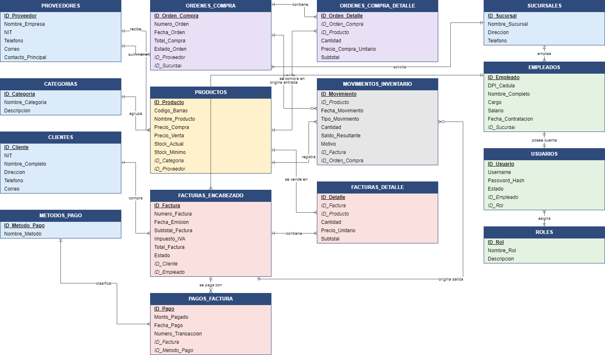

# Justificación de las relaciones

Este documento explica cada relación del modelo: su cardinalidad, la llave foránea que la implementa, la regla de negocio que la origina y el comportamiento al eliminar el registro padre. El diagrama completo está en [`img/modelo_er.png`](img/modelo_er.png) y el modelo relacional en [`img/modelo_relacional.png`](img/modelo_relacional.png).



## 1. Relaciones del modelo (18 llaves foráneas)

| # | Relación (padre → hijo) | Cardinalidad | Llave foránea | Participación del hijo | Al eliminar el padre | Regla de negocio |
|---|------------------------|--------------|---------------|------------------------|----------------------|------------------|
| 1 | `CATEGORIAS` → `PRODUCTOS` | 1:N | `PRODUCTOS.ID_Categoria` | Obligatoria (`NOT NULL`) | `RESTRICT` implícito (no se puede eliminar si tiene hijos) | Todo producto pertenece a una categoría; una categoría agrupa muchos productos. |
| 2 | `PROVEEDORES` → `PRODUCTOS` | 1:N | `PRODUCTOS.ID_Proveedor` | Obligatoria (`NOT NULL`) | `RESTRICT` implícito (no se puede eliminar si tiene hijos) | Todo producto tiene un proveedor habitual; un proveedor suministra muchos productos. |
| 3 | `SUCURSALES` → `EMPLEADOS` | 1:N | `EMPLEADOS.ID_Sucursal` | Obligatoria (`NOT NULL`) | `RESTRICT` implícito (no se puede eliminar si tiene hijos) | Cada empleado labora en una sucursal; una sucursal tiene muchos empleados. |
| 4 | `EMPLEADOS` → `USUARIOS` | 1:1 | `USUARIOS.ID_Empleado` | Obligatoria y única (`NOT NULL` + `UNIQUE`) | `CASCADE` (al eliminar el empleado se elimina su cuenta) | Un empleado tiene como máximo una cuenta de acceso y cada cuenta pertenece a un solo empleado. |
| 5 | `ROLES` → `USUARIOS` | 1:N | `USUARIOS.ID_Rol` | Obligatoria (`NOT NULL`) | `RESTRICT` implícito (no se puede eliminar si tiene hijos) | Cada usuario tiene un rol; un rol se asigna a muchos usuarios. |
| 6 | `CLIENTES` → `FACTURAS_ENCABEZADO` | 1:N | `FACTURAS_ENCABEZADO.ID_Cliente` | Obligatoria (`NOT NULL`) | `RESTRICT` implícito (no se puede eliminar si tiene hijos) | Cada factura se emite a un cliente; un cliente puede tener muchas facturas. |
| 7 | `EMPLEADOS` → `FACTURAS_ENCABEZADO` | 1:N | `FACTURAS_ENCABEZADO.ID_Empleado` | Obligatoria (`NOT NULL`) | `RESTRICT` implícito (no se puede eliminar si tiene hijos) | Cada factura la registra un empleado; un empleado registra muchas facturas. |
| 8 | `FACTURAS_ENCABEZADO` → `FACTURAS_DETALLE` | 1:N | `FACTURAS_DETALLE.ID_Factura` | Obligatoria (`NOT NULL`) | `RESTRICT` implícito (no se puede eliminar si tiene hijos) | Una factura tiene una o más líneas; cada línea pertenece a una sola factura. |
| 9 | `PRODUCTOS` → `FACTURAS_DETALLE` | 1:N | `FACTURAS_DETALLE.ID_Producto` | Obligatoria (`NOT NULL`) | `RESTRICT` implícito (no se puede eliminar si tiene hijos) | Un producto puede aparecer en muchas líneas de factura. |
| 10 | `FACTURAS_ENCABEZADO` → `PAGOS_FACTURA` | 1:N | `PAGOS_FACTURA.ID_Factura` | Un pago siempre tiene factura; una factura puede no tener pagos | `RESTRICT` implícito (no se puede eliminar si tiene hijos) | Una factura puede recibir uno o varios pagos (o ninguno si está pendiente). |
| 11 | `METODOS_PAGO` → `PAGOS_FACTURA` | 1:N | `PAGOS_FACTURA.ID_Metodo_Pago` | Obligatoria (`NOT NULL`) | `RESTRICT` implícito (no se puede eliminar si tiene hijos) | Cada pago usa un método; un método se usa en muchos pagos. |
| 12 | `PROVEEDORES` → `ORDENES_COMPRA` | 1:N | `ORDENES_COMPRA.ID_Proveedor` | Obligatoria (`NOT NULL`) | `RESTRICT` implícito (no se puede eliminar si tiene hijos) | Cada orden se dirige a un proveedor; un proveedor recibe muchas órdenes. |
| 13 | `SUCURSALES` → `ORDENES_COMPRA` | 1:N | `ORDENES_COMPRA.ID_Sucursal` | Obligatoria (`NOT NULL`) | `RESTRICT` implícito (no se puede eliminar si tiene hijos) | Cada orden la solicita una sucursal; una sucursal solicita muchas órdenes. |
| 14 | `ORDENES_COMPRA` → `ORDENES_COMPRA_DETALLE` | 1:N | `ORDENES_COMPRA_DETALLE.ID_Orden_Compra` | Obligatoria (`NOT NULL`) | `RESTRICT` implícito (no se puede eliminar si tiene hijos) | Una orden tiene una o más líneas. |
| 15 | `PRODUCTOS` → `ORDENES_COMPRA_DETALLE` | 1:N | `ORDENES_COMPRA_DETALLE.ID_Producto` | Obligatoria (`NOT NULL`) | `RESTRICT` implícito (no se puede eliminar si tiene hijos) | Un producto puede aparecer en muchas órdenes de compra. |
| 16 | `PRODUCTOS` → `MOVIMIENTOS_INVENTARIO` | 1:N | `MOVIMIENTOS_INVENTARIO.ID_Producto` | Obligatoria (`NOT NULL`) | `RESTRICT` implícito (no se puede eliminar si tiene hijos) | Cada movimiento afecta a un producto; un producto acumula muchos movimientos. |
| 17 | `FACTURAS_ENCABEZADO` → `MOVIMIENTOS_INVENTARIO` | 1:N | `MOVIMIENTOS_INVENTARIO.ID_Factura` | Opcional (la FK admite `NULL` o no existe el hijo) | `SET NULL` (el kárdex se conserva aunque se elimine la factura) | Las salidas por venta apuntan a su factura (opcional: no todo movimiento es una venta). |
| 18 | `ORDENES_COMPRA` → `MOVIMIENTOS_INVENTARIO` | 1:N | `MOVIMIENTOS_INVENTARIO.ID_Orden_Compra` | Opcional (la FK admite `NULL` o no existe el hijo) | `SET NULL` (el kárdex se conserva aunque se elimine la orden) | Las entradas por compra apuntan a su orden (opcional: no todo movimiento es una compra). |

## 2. Tablas puente: relaciones muchos a muchos

### 2.1 `FACTURAS_DETALLE`: puente entre facturas y productos

Entre `FACTURAS_ENCABEZADO` y `PRODUCTOS` existe una relación **muchos a muchos (M:N)**:

- Una factura incluye **varios** productos.
- Un producto aparece en **muchas** facturas.

Una relación M:N no puede representarse con una sola llave foránea. Se resuelve con la tabla puente `FACTURAS_DETALLE`, que contiene dos llaves foráneas (`ID_Factura` y `ID_Producto`) y convierte la relación en dos relaciones 1:N:

```
FACTURAS_ENCABEZADO 1 ────< FACTURAS_DETALLE >──── 1 PRODUCTOS
```

Además, la tabla puente guarda los **atributos propios de la relación**, que no pertenecen ni a la factura ni al producto:

- `Cantidad`: unidades vendidas de ese producto en esa factura.
- `Precio_Unitario`: precio al momento de la venta. Se almacena porque el precio del catálogo cambia con el tiempo y la factura debe conservar lo que realmente se cobró.
- `Subtotal`: columna virtual `Cantidad × Precio_Unitario`, calculada por la base de datos.

### 2.2 `ORDENES_COMPRA_DETALLE`: puente entre órdenes de compra y productos

Mismo razonamiento para las compras: una orden incluye varios productos y un producto se compra en muchas órdenes. Aquí se agrega `UNIQUE (ID_Orden_Compra, ID_Producto)` para que un producto aparezca una sola vez por orden.

## 3. Relaciones con características especiales

- **`EMPLEADOS` 1:1 `USUARIOS`**: la restricción `UNIQUE` sobre `USUARIOS.ID_Empleado` impide que un empleado tenga dos cuentas. La cuenta es una extensión del empleado, por eso se elimina en cascada con él.
- **`MOVIMIENTOS_INVENTARIO` con dos orígenes opcionales**: cada movimiento del kárdex nace de una factura (salida), de una orden de compra (entrada) o de ninguna (inventario inicial). Por eso `ID_Factura` e `ID_Orden_Compra` admiten `NULL`, y `CK_Mov_Origen` garantiza que un movimiento no tenga ambos orígenes a la vez.
- **`FACTURAS_ENCABEZADO` → `PAGOS_FACTURA`**: una factura puede recibir varios pagos (pagos parciales) o ninguno (estado `PENDIENTE`). La consulta Q6 del reporte calcula el saldo pendiente con esta relación.

## 4. Justificación de la ampliación del modelo base

La guía del proyecto propone un modelo mínimo de 6 tablas (`CATEGORIAS`, `PROVEEDORES`, `CLIENTES`, `PRODUCTOS`, `FACTURAS_ENCABEZADO`, `FACTURAS_DETALLE`) y permite ampliarlo siempre que se mantenga la 3FN y se justifique. Se agregaron 9 tablas:

| Tabla agregada | Necesidad del negocio que resuelve |
|----------------|-------------------------------------|
| `ORDENES_COMPRA` y `ORDENES_COMPRA_DETALLE` | Registrar las entradas de inventario por proveedor. Permite el reporte «compras por proveedor» con datos reales (consultas Q3 y Q8) en lugar de aproximarlo con el valor del inventario. |
| `MOVIMIENTOS_INVENTARIO` (kárdex) | Trazabilidad de cada entrada y salida de stock. Permite auditar el inventario y verificar que `Stock_Actual` coincide con el historial (consulta Q4 y la verificación final de `05_extras_opcional.sql`). |
| `PAGOS_FACTURA` y `METODOS_PAGO` | Separar la factura (lo vendido) del pago (lo cobrado): permite pagos parciales, cierre de caja por forma de pago (Q5) y cuentas por cobrar (Q6). |
| `SUCURSALES` | El negocio opera en varias sucursales; las compras y los vendedores se asocian a una. |
| `EMPLEADOS` | Identificar quién realiza cada venta (reporte Q7 de ventas por sucursal y empleado). |
| `USUARIOS` y `ROLES` | Control de acceso al sistema: cada empleado puede tener una cuenta con un rol (administrador, cajero, bodeguero, etc.). |

Todas las tablas agregadas cumplen la 3FN (ver [`04_normalizacion.md`](04_normalizacion.md)).
