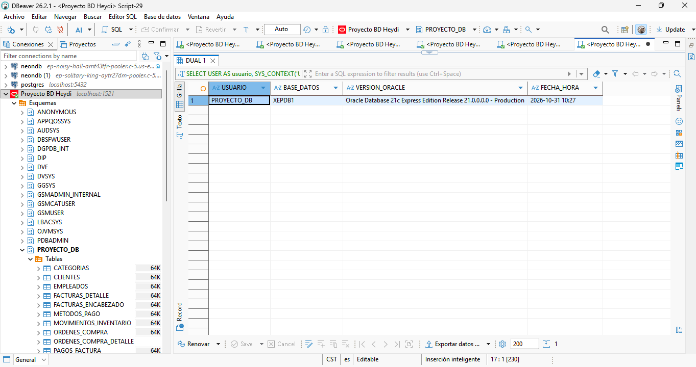
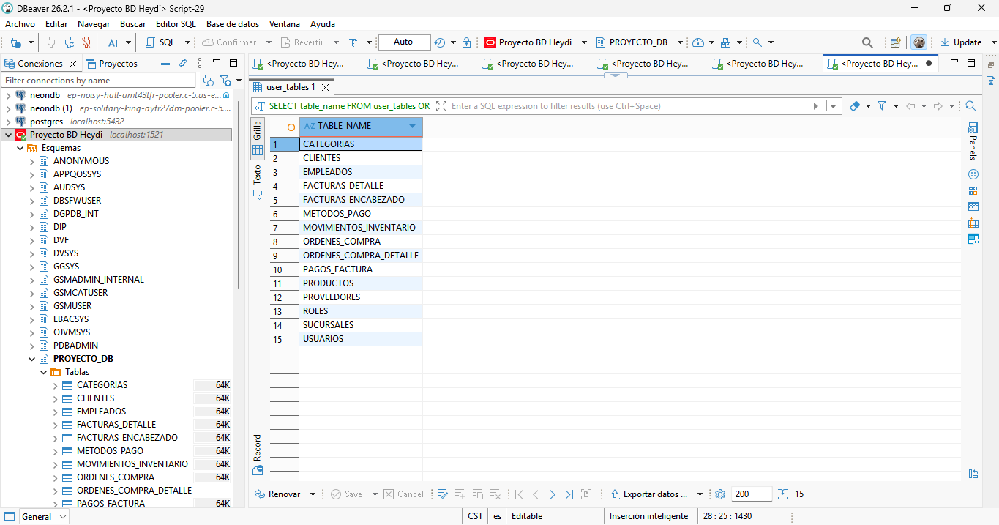
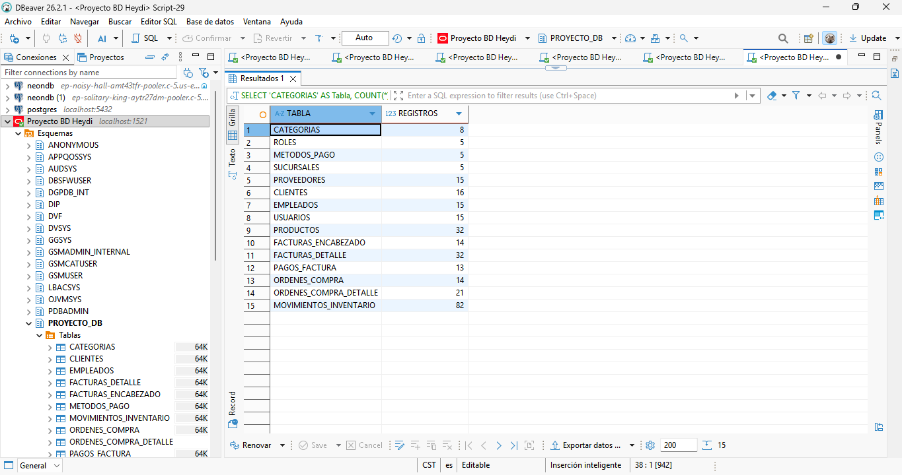
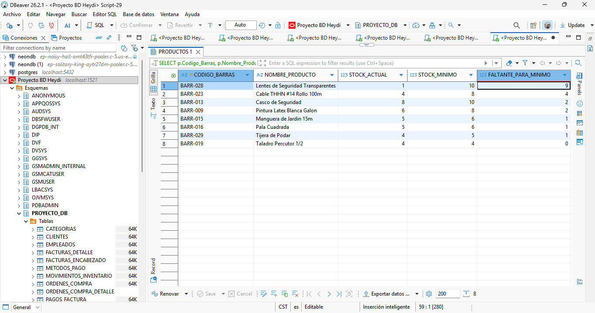
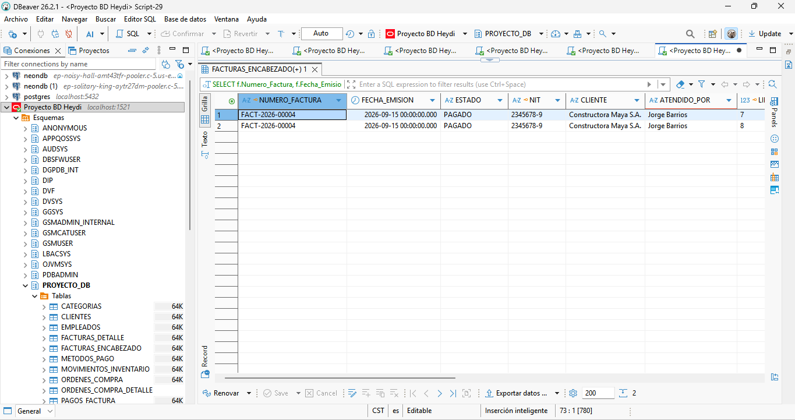
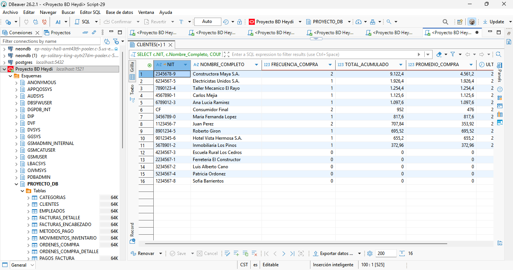
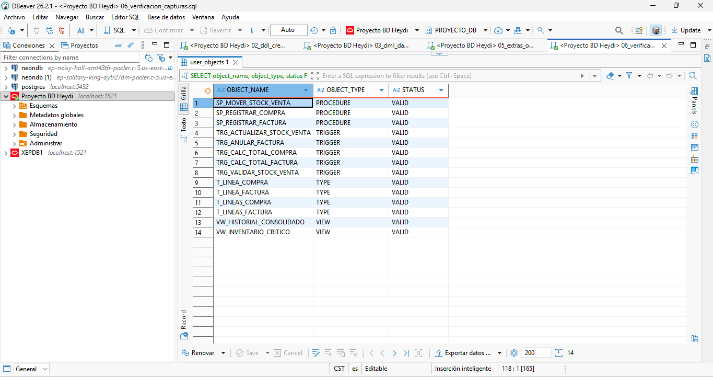
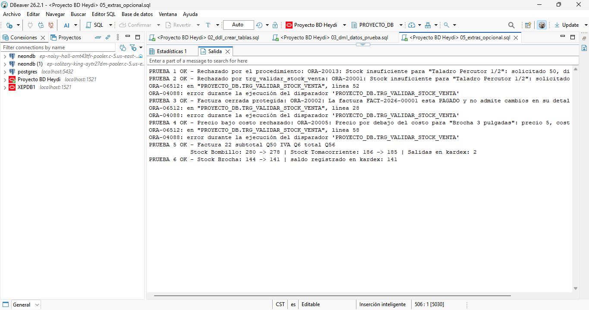
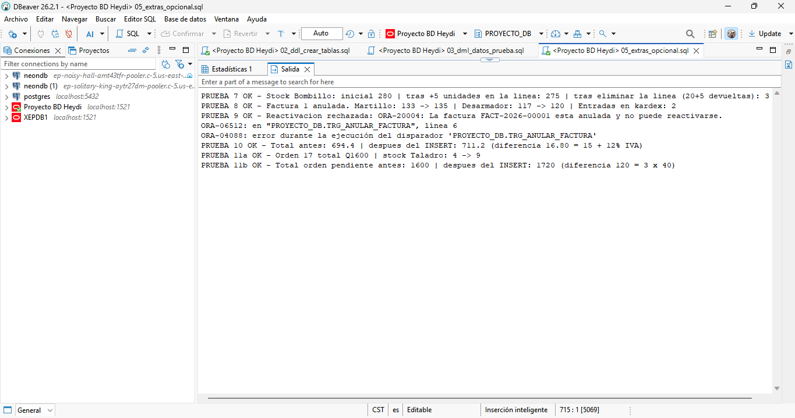

# Guía paso a paso para reproducir la base de datos

Esta guía permite crear la base de datos desde cero en una instalación limpia de Oracle.

## 1. Requisitos previos

| Requisito | Detalle |
|-----------|---------|
| Motor | Oracle Database **12c o superior**. El proyecto se desarrolló en **Oracle Database 21c Express Edition**. Se requieren columnas `IDENTITY`, columnas virtuales y `FETCH FIRST`. |
| Cliente SQL | **DBeaver** (usado en el proyecto). También funcionan SQL Developer y SQLcl. |
| Cuenta administrativa | `SYSTEM` o `SYS`, solo para el script 01 (puede omitirse si el usuario `PROYECTO_DB` ya existe). |
| Nombre del PDB | `XEPDB1` en Oracle 21c XE. Verifíquelo con `SELECT name FROM v$pdbs;`. |

## 2. Obtener el proyecto

```bash
git clone https://github.com/<usuario>/inventario-facturacion-bd.git
cd inventario-facturacion-bd/sql
```

## 3. Orden de ejecución de los scripts

Los scripts están numerados en el orden exacto en que deben ejecutarse. En DBeaver use **Ejecutar script** (Alt+X), no *Ejecutar sentencia* (Ctrl+Enter). Antes del script 01 reemplace `<SU_CONTRASENA>` por su contraseña.

| Paso | Script | Se ejecuta como | Qué hace |
|------|--------|-----------------|----------|
| 1 | `01_ddl_crear_base_datos.sql` | `SYSTEM` conectado a `XEPDB1` | Crea el esquema `PROYECTO_DB` si no existe y le asigna privilegios. La contraseña se escribe en el script antes de ejecutarlo y no se sube al repositorio. |
| 2 | `02_ddl_crear_tablas.sql` | `PROYECTO_DB` | Elimina objetos previos (re-ejecutable), crea 2 secuencias, 15 tablas con sus restricciones y los índices. |
| 3 | `03_dml_datos_prueba.sql` | `PROYECTO_DB` | Inserta los datos de prueba y confirma con `COMMIT`. |
| 4 | `04_consultas_reportes.sql` | `PROYECTO_DB` | Ejecuta los reportes Q1–Q15 (solo lectura). |
| 5 | `05_extras_opcional.sql` | `PROYECTO_DB` | Crea tipos, triggers (verificación de venta y actualización de stock), procedimientos y vistas, y ejecuta 11 pruebas. |

> **Importante:** no ejecute el paso 3 después del paso 5 sin volver a ejecutar el paso 2. Los datos de prueba ya incluyen los movimientos de stock; con los triggers activos el inventario se descontaría dos veces. El paso 2 recrea todo y deja el entorno limpio.

Alternativa: el archivo `Fase_2_corregido.sql` (en la raíz de la entrega de la Fase 2) contiene los pasos 2, 3, 5 y 4 en un solo script.

## 4. Cómo verificar que todo se creó correctamente

### 4.1 Listar las tablas (debe devolver 15)

```sql
SELECT table_name FROM user_tables ORDER BY table_name;
```

### 4.2 Contar registros (la primera consulta de `04_consultas_reportes.sql`)

| Tabla | Registros esperados |
|-------|--------------------:|
| CATEGORIAS | 8 |
| ROLES | 5 |
| METODOS_PAGO | 5 |
| SUCURSALES | 5 |
| PROVEEDORES | 15 |
| CLIENTES | 16 |
| EMPLEADOS | 15 |
| USUARIOS | 15 |
| PRODUCTOS | 32 |
| FACTURAS_ENCABEZADO | 14 |
| FACTURAS_DETALLE | 32 |
| PAGOS_FACTURA | 13 |
| ORDENES_COMPRA | 14 |
| ORDENES_COMPRA_DETALLE | 21 |
| MOVIMIENTOS_INVENTARIO | 82 |

### 4.3 Verificar triggers, procedimientos y vistas (después del paso 5)

```sql
SELECT object_name, object_type, status
  FROM user_objects
 WHERE object_type IN ('TRIGGER', 'PROCEDURE', 'VIEW', 'TYPE')
 ORDER BY object_type, object_name;
```

Deben aparecer 5 triggers (`TRG_ACTUALIZAR_STOCK_VENTA`, `TRG_ANULAR_FACTURA`, `TRG_CALC_TOTAL_COMPRA`, `TRG_CALC_TOTAL_FACTURA`, `TRG_VALIDAR_STOCK_VENTA`), 3 procedimientos (`SP_MOVER_STOCK_VENTA`, `SP_REGISTRAR_COMPRA`, `SP_REGISTRAR_FACTURA`), 2 vistas y 4 tipos, todos con estado `VALID`. Para detectar errores de compilación:

```sql
SELECT object_name, object_type FROM user_objects WHERE status = 'INVALID';   -- debe devolver 0 filas
```

### 4.4 Resultado esperado de las pruebas del paso 5

Abra el panel **Salida** de DBeaver (Ctrl+Shift+O) antes de ejecutar. Deben aparecer 12 líneas `PRUEBA ... OK`. En las pruebas de rechazo (1 a 4 y 9) DBeaver muestra además la pila `ORA-06512` / `ORA-04088`; es normal:

| Prueba | Qué demuestra | Resultado esperado |
|--------|---------------|--------------------|
| 1 | Venta rechazada por el procedimiento | `ORA-20013: Stock insuficiente para "Taladro Percutor 1/2": solicitado 50, disponible 4.` |
| 2 | `INSERT` directo rechazado por el trigger | `ORA-20001: Stock insuficiente ...` |
| 3 | Factura pagada protegida | `ORA-20002: La factura FACT-2026-00001 esta PAGADO y no admite cambios en su detalle.` |
| 4 | Venta bajo el costo rechazada | `ORA-20005: Precio por debajo del costo para "Brocha 3 pulgadas": precio 5, costo 7.` |
| 5 | Factura por procedimiento | subtotal Q50, IVA Q6, total Q56; stock Bombillo 280 → 278, Tomacorriente 186 → 185; 2 salidas en kárdex |
| 6 | `INSERT` directo descuenta stock | Stock Brocha 144 → 141; saldo del kárdex 141 |
| 7 | `UPDATE` y `DELETE` ajustan stock | Bombillo: inicial 280, tras +5 unidades 275, tras eliminar la línea 300 |
| 8 | Anulación devuelve stock | Martillo 133 → 135, Desarmador 117 → 120, 2 entradas en kárdex |
| 9 | No se reactiva una factura anulada | `ORA-20004: La factura FACT-2026-00001 esta anulada y no puede reactivarse.` |
| 10 | Total de factura recalculado | 694.4 → 711.2 (diferencia 16.80) |
| 11a / 11b | Compra y total de orden | Stock Taladro 4 → 9; total de orden pendiente 1600 → 1720 |

Los números de factura u orden que muestran las pruebas 5 y 11 pueden variar. Todas las pruebas terminan con `ROLLBACK`, por lo que los datos no cambian.

Al final del script, la consulta de coherencia kárdex–stock debe devolver **0 filas**.

## 5. Capturas de pantalla (evidencia)

Los scripts cambiaron respecto a la Fase 2 (más datos, dos triggers nuevos y más reportes), por lo que los conteos y objetos de las capturas de esa fase ya no coinciden. Solo la conexión (Figura 1 de la Fase 2) puede reutilizarse tal cual; el resto conviene repetirlo con el script final.

Guarde las capturas en `docs/img/capturas/` con estos nombres; el documento las mostrará automáticamente.

| Archivo | Qué capturar |
|---------|--------------|
| `01_usuario_creado.png` | Resultado del script 01 (fila de `PROYECTO_DB`) |
| `02_tablas_creadas.png` | Consulta 4.1 con las 15 tablas |
| `03_conteo_registros.png` | Conteo de registros por tabla |
| `04_bajo_stock_q9.png` | Reporte Q9 de productos con bajo stock |
| `05_factura_completa_q11.png` | Reporte Q11 de factura completa |
| `06_ventas_cliente_q2.png` | Reporte Q2 de ventas por cliente |
| `07_triggers_validos.png` | Consulta 4.3 con los objetos en estado `VALID` |
| `08_pruebas_dbms_output.png` | Salida de las pruebas 1 a 6 |
| `08b_pruebas_dbms_output.png` | Salida de las pruebas 7 a 11 (se capturan por separado porque el panel Salida de DBeaver puede perder líneas al ejecutar todo junto) |











## 6. Problemas comunes y soluciones

| Síntoma | Causa | Solución |
|---------|-------|----------|
| `ORA-65096: invalid common user or role name` | El script 01 se ejecutó en la raíz (CDB$ROOT). | Cree la conexión de `SYSTEM` apuntando al servicio `XEPDB1`. |
| `ORA-01017: invalid username/password` | Contraseña incorrecta al conectarse como `PROYECTO_DB`. | Vuelva a ejecutar el script 01 con la contraseña deseada. |
| `ORA-01031: insufficient privileges` | El script 01 se ejecutó sin cuenta administrativa. | Conéctese como `SYSTEM` o `SYS`. |
| `ORA-01950: no privileges on tablespace 'USERS'` | El tablespace del usuario no existe o no tiene cuota. | Verifique que exista `USERS` o cambie `DEFAULT TABLESPACE` en el script 01. |
| `ORA-00955: name is already used by an existing object` | Se ejecutó el DDL sobre objetos existentes. | Ejecute el script 02 completo: su primer bloque elimina los objetos anteriores. |
| `ORA-00001: unique constraint violated` o `ORA-02291` al cargar datos | El script 03 se ejecutó dos veces seguidas. | Ejecute 02 y luego 03. |
| Stock descontado dos veces | Se ejecutó el script 03 con los triggers ya creados. | Ejecute 02, 03 y 05 en ese orden. |
| `PLS-00201` o `Warning: compiled with errors` | Falta crear tipos u objetos previos. | Ejecute 05 completo; use `SHOW ERRORS` o consulte `user_errors`. |
| No se ven los mensajes `PRUEBA ... OK` | El panel de salida está cerrado. | Abra el panel **Salida** (Ctrl+Shift+O) y vuelva a ejecutar el script 05. |
| `ORA-00900` o una ventana «Enlazar parámetros» con `:OLD` / `:NEW` | El cliente interpretó un `/` como parte de la siguiente sentencia. Los scripts de este repositorio no usan `/` (están escritos para DBeaver). | Pulse **Cancelar** y **Parar**; no use *Skip all*. Si trabaja con SQL*Plus o SQL Developer, agregue una línea con `/` tras cada bloque PL/SQL. |
| Solo se ejecutó la primera sentencia | Se usó *Ejecutar sentencia* (Ctrl+Enter). | Use *Ejecutar script* (Alt+X). |
| `ORA-20001` ... `ORA-20016` durante las pruebas | Son los errores **esperados**: muestran que las validaciones funcionan. | No es un fallo; revise la tabla 4.4. |
